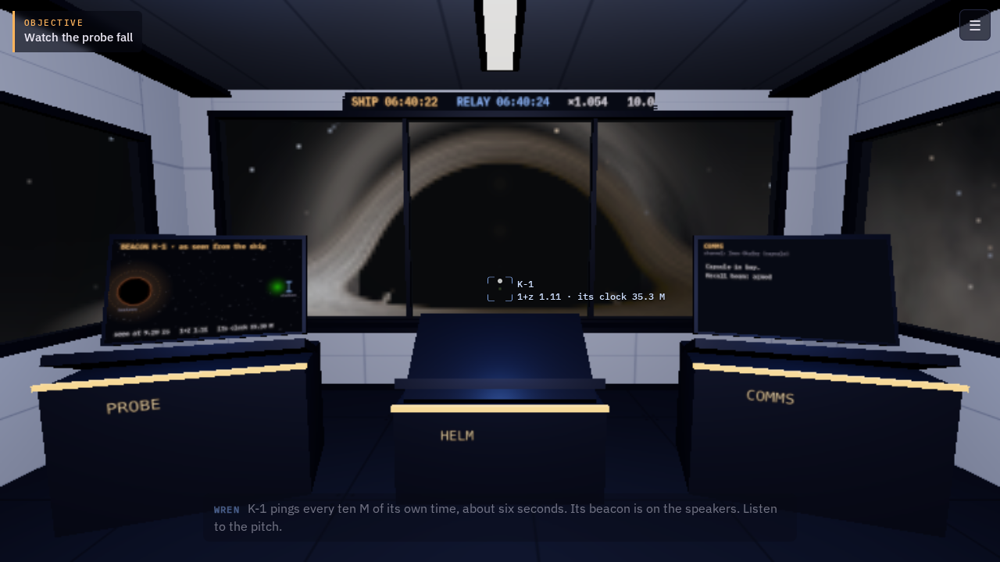
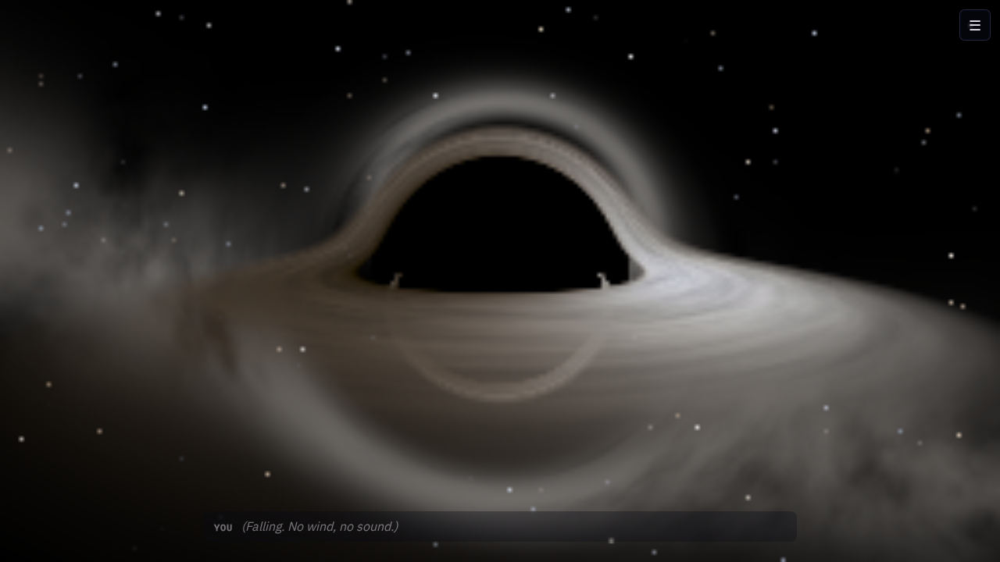
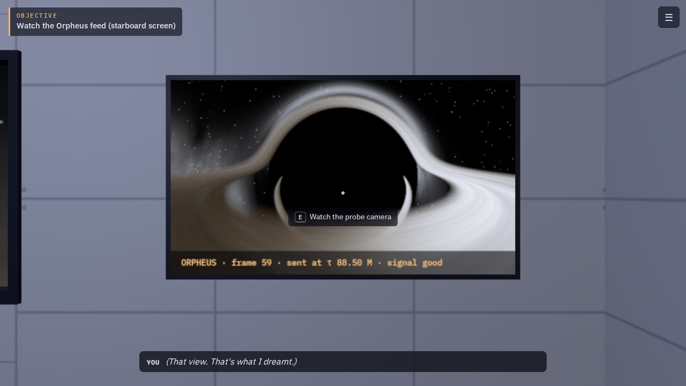
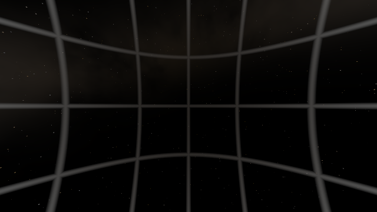

# Frozen Star

A first-person game about general relativity. You wake aboard the research vessel *Tern*, holding station 10 Schwarzschild radii above Erebus, a black hole of 120,000 suns. Today you find out whether things really fall in. From far away, nothing ever seems to: it slows, reddens and fades at the edge. On its own clock it falls straight through.



The old Soviet name for black holes was "frozen stars", after the frozen image a distant observer sees.

## The story

1. **A dream** of falling in. At the horizon, nothing happens.
2. **Wake up** in your quarters and walk to the bridge.
3. **Beacon K-1.** Drop a probe and watch its light freeze in the window. Its beacon is on the speakers, so you hear the pitch slide down as it redshifts.
4. **The rescue.** Ines's capsule loses power and drifts in. Her radio messages arrive slower and redder. Fire the recall beam in time, but the picture on your screen is old light.
5. **The helm.** Hover the ship near the horizon while the relay clock races ahead.
6. **Orpheus.** A camera probe streams frames that arrive further and further apart, then freeze just before the horizon.
7. **Explore.** The original training chapters live on the lab's archive terminal.

Everything happens at its true speed: at 120,000 suns, one unit of black-hole time (GM/c³) is 0.59 seconds.





## The physics is real

- **Exact Schwarzschild geometry.** Fall times, the station's view, redshift, rescue deadlines, tides and hovering come from closed-form solutions. See [docs/PHYSICS.md](docs/PHYSICS.md).
- **A real light-ray tracer.** The 3D views trace a ray per pixel through Painlevé–Gullstrand coordinates. Their slices are flat, so the camera works inside the horizon too. Colours shift by the true Doppler and gravitational frequency ratio.
- **Tested.** `test/physics.test.js` checks the formulas against each other and the tracer against textbook results: weak-field bending of 4M/b, and the shadow edge at an impact parameter of 3√3 M.



## Run it

There is no build step. Serve the folder and open it:

```sh
python3 tools/serve.py . 8000      # or any static file server
# then open http://localhost:8000/
```

The game needs WebGL 2. Add `?lowgpu` to the URL on slow machines. Controls: WASD and mouse (click to capture), E to use, Space to skip a line; on touch, left thumb walks and dragging looks; gamepads work too. On Windows, `tools/play-frozen-star.bat` opens it as a desktop app: the first run downloads a checksum-pinned Electron runtime (45.2.0, about 160 MB), then every launch copies the latest files from the WSL clone into it. `play-frozen-star.bat browser` plays in the browser instead. The Electron shell lives in `desktop/` (F11 fullscreen, F5 reload).

three.js r170 is vendored in `vendor/three` (MIT).

## Test

```sh
npm test          # node --test, no dependencies
```

`tools/tour.cjs` (training chapters) and `tools/fp-shots.cjs` (the first-person game; `?debug&cp=<checkpoint>&timescale=N`) drive headless Chromium and save screenshots (need Playwright).
