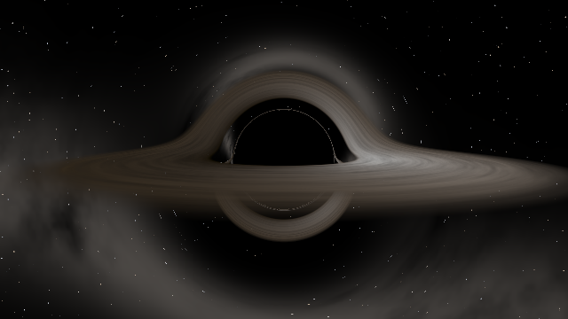
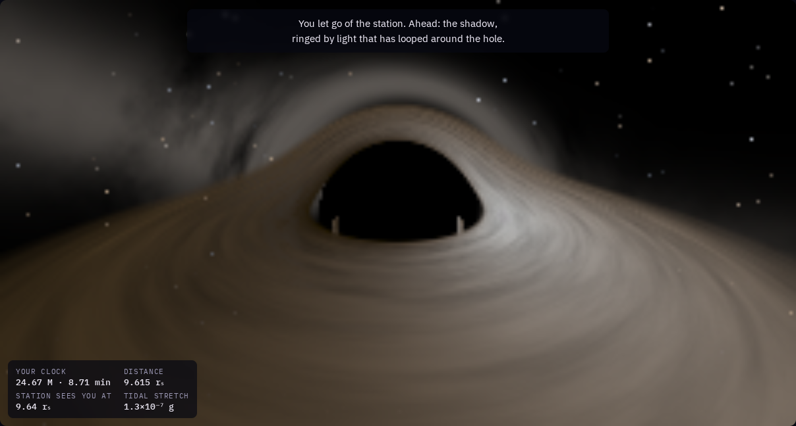
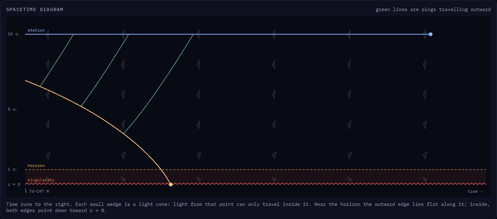

# Frozen Star

A browser game about general relativity. From far away, nothing is ever seen to fall into a black hole: it slows, reddens and fades at the edge. On its own clock it falls straight through. Seven chapters show why both are true.



The old Soviet name for black holes was "frozen stars", after the frozen image a distant observer sees.

## Chapters

| # | Chapter | What you learn |
|---|---------|----------------|
| 1 | **Two Clocks** | A probe's pings arrive later and later; its image reddens, freezes and fades. |
| 2 | **Last Words** | The horizon is a one-way door: messages sent from inside never get out. |
| 3 | **The Rescue** | The image on your screen is old light. By the time it looks worrying, it is too late. |
| 4 | **Pick Your Hole** | Tides at the horizon scale as 1/M²: small holes shred you, big ones don't. |
| 5 | **Hover** | Hovering near the horizon slows your clock, at a crushing cost in thrust. |
| 6 | **Into the Dark** | Fall in yourself, first person, ray-traced through the horizon. |
| 7 | **Evaporation** | Why Hawking evaporation doesn't save "you never fall in". |
| + | **Observatory** | A free camera around the hole. |





## The physics is real

- **Exact Schwarzschild geometry.** Fall times, the station's view, redshift, rescue deadlines, tides and hovering come from closed-form solutions. See [docs/PHYSICS.md](docs/PHYSICS.md).
- **A real light-ray tracer.** The 3D views trace a ray per pixel through Painlevé–Gullstrand coordinates. Their slices are flat, so the camera works inside the horizon too. Colours shift by the true Doppler and gravitational frequency ratio.
- **Tested.** `test/physics.test.js` checks the formulas against each other and the tracer against textbook results: weak-field bending of 4M/b, and the shadow edge at an impact parameter of 3√3 M.


## Run it

There is no build step. Serve the folder with any static file server and open `index.html`:

```sh
python3 -m http.server 8000
# then open http://localhost:8000/
```

The 3D views need WebGL 2. Add `?lowgpu` to the URL on slow machines.

## Test

```sh
npm test          # node --test, no dependencies
```

`tools/tour.cjs` drives every screen in headless Chromium and saves screenshots (needs Playwright).
