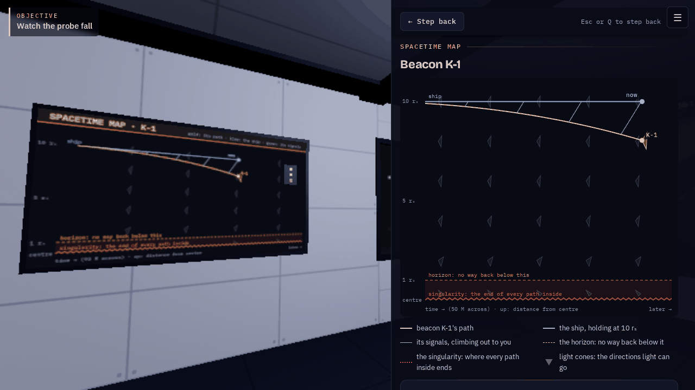
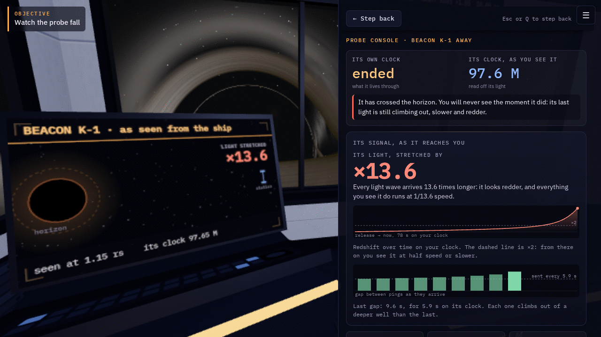
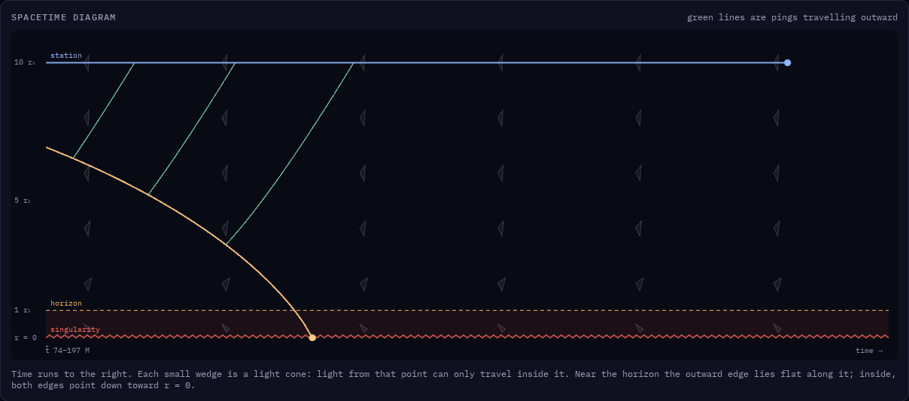
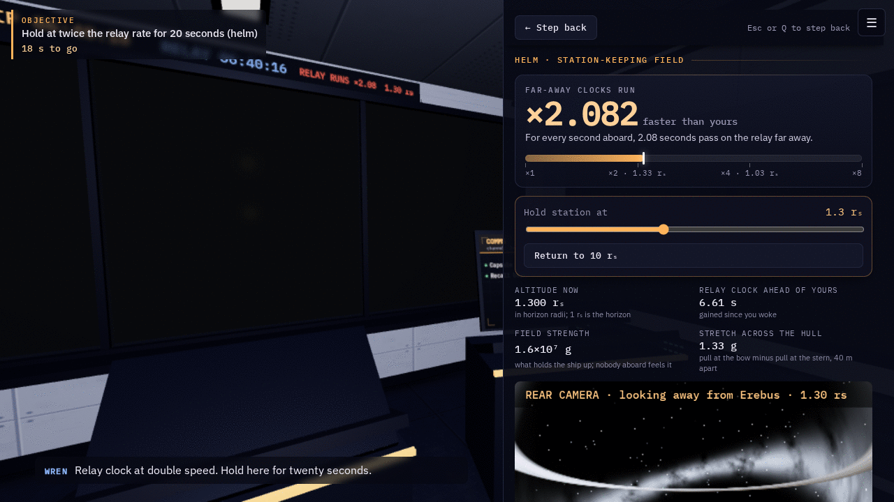
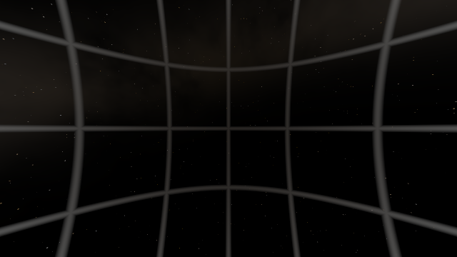
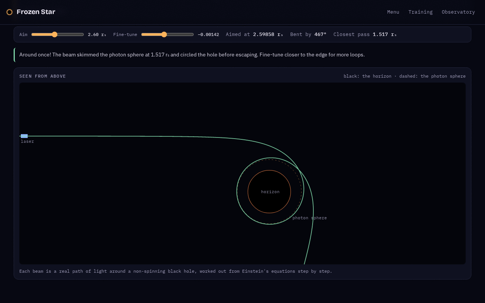

# The physics in Frozen Star

All of it is the Schwarzschild solution: a black hole that doesn't spin and has no charge. Units are geometric (G = c = 1), with lengths and times in units of the hole's mass M. The horizon is at r = 2M (one Schwarzschild radius, rₛ). Converting to real seconds multiplies by GM/c³ = 4.925 µs per solar mass.

## The fall (`src/physics/infall.js`)

The probe is released from rest beside a station hovering at R₀ = 20M (10 rₛ). Radial free fall from rest follows a cycloid (MTW §25.5):

- r = (R₀/2)(1 + cos η)
- τ = √(R₀³/8M) (η + sin η)

It reaches the horizon at τ_H = 97.97 M and r = 0 at τ = π√(R₀³/8M) = 99.35 M. Schwarzschild coordinate time t(η) is MTW eq. 31.10; it diverges at the horizon.

**Through the horizon.** Ingoing Eddington–Finkelstein time v obeys dv/dτ = 1 / (E + √(E² − 1 + 2/r)), which stays finite at r = 2. Here E = √(1 − 2/R₀). The diagrams plot t̃ = v − r, which is smooth all the way to r = 0.

*The ship's spacetime map plots exactly this: the probe's worldline in t̃ and r, which stays smooth at the horizon, with the light cones tipping inward as it nears r = 2M.*

**What the station sees.** Light sent outward at η reaches the station at station proper time S = √f₀ · [t(η) + r*(R₀) − r*(r)]. Here r* = r + 2 ln(r/2 − 1) is the tortoise coordinate and f₀ = 1 − 2/R₀. The received frequency ratio is

1 + z = √f₀ · (E + √(2/r − 2/R₀)) / (1 − 2/r)

This equals dS/dτ, which the tests verify. Near the horizon the redshift grows by a factor of e every 4M of coordinate time.

*The probe console charts 1 + z on the ship's clock as it arrives. The curve bends upward without limit, and the bars show the pings arriving further apart even though K-1 sent them at an even pace.*

*From the Two Clocks lesson: each ping is a light ray from the probe's worldline to the station's. The closer to the horizon it leaves, the longer it takes to climb out.*

**The rescue deadline.** An inward light pulse sent at station time S meets the probe where v_probe = S/√f₀ + r*(R₀). The last pulse that meets it outside the horizon is the one with v = v_H. For R₀ = 20M that deadline is S = 83.6 M. At that moment the station sees the probe at about 6 rₛ, redshifted by only 1 + z ≈ 1.37.

## Tides, hovering, evaporation (`src/physics/body.js`)

- **Tidal stretch** across length L at radius R: Δa = 2GML/R³. At the horizon this is c⁶L / (4G²M²), so it scales as 1/M². A 2 m body feels 10 g at the horizon of a hole of about 14,500 suns.
- **Hovering** at r: the clock runs at √(1 − 2M/r) of a far clock. The proper acceleration needed is GM / (r² √(1 − 2M/r)), which diverges at the horizon.

*At 1.3 rₛ, √(1 − 2M/r) = 0.48: every second aboard is about 2.08 seconds on the far relay.*

- **Longest time inside**: πGM/c³, for a fall from rest just above the horizon.
- **Hawking lifetime**: about 2.1 × 10⁶⁷ (M/M☉)³ years (photon emission only; order of magnitude, after Page 1976). **Temperature**: 6.17 × 10⁻⁸ (M☉/M) K.

## Light rays (`src/physics/geodesic.js`, `src/render/raytracer.js`)

The tracer uses Painlevé–Gullstrand coordinates, in which constant-time slices are flat Euclidean space. Observers who fall from rest at infinity ("rain" observers) are at rest on those slices. Null geodesics come from the Hamiltonian

H = ½(−E² − 2βE s + |p|² − β² s²),  β = √(2M/r),  s = p·r̂,

which is regular at the horizon. The camera's velocity relative to the rain frame (outward β for a hovering observer; computed from E for a faller from rest at R₀) is applied as a Lorentz boost, which gives aberration and Doppler shift. The colour of each ray uses g = ν_received / ν_emitted:

- for the sky, g = 1 / (E_cam-normalised conserved energy);
- for the disk, a thin Keplerian disk from 6M (the innermost stable circular orbit) with emitter 4-velocity uᵗ = 1/√(1 − 3M/r), Ω = √(M/r³).

Received brightness scales as g⁴. Colour comes from a blackbody at the shifted temperature.

*Because the Painlevé–Gullstrand slices are flat and regular at r = 2M, the same tracer renders the view from inside the horizon: here the dream's faller at r = 1.4M. Light from outside keeps falling in after you, so the sky stays visible to the end.*

*The Bend the Light lesson integrates the orbit equation u″ + u = 3Mu² for one beam at a time (`src/physics/light.js`). Aimed inside b = 3√3 M ≈ 2.6 rₛ the beam is captured, which is why the shadow is 2.6 times the horizon's size.*

**The photon sphere (`src/physics/photon-orbit.js`).** In the story's postscript the Tern hovers at r = 3M (1.5 rₛ) and fires a laser pulse sideways. A pulse fired tangentially at r₀ has b = r₀ / √(1 − 2M/r₀) and follows the same orbit equation, with Schwarzschild time dt/dφ = r² / (b(1 − 2M/r)). At r₀ = 3M it circles: one lap takes 2π·3√3 M of far-away time (19.3 s at Erebus) and 2π·3M = 6πM on the hovering clock (11.1 s), the circumference divided by c. The orbit is unstable: linearising about u = 1/3M gives δu″ = δu, so an offset grows as cosh φ, about 268 times per lap. A pulse fired one metre too high is 268 m off after one lap and 143 km off after two, and then spirals out to the stars. Hovering there, the shadow covers exactly half the sky, and light that leaves the ship sideways (from the back of your head, say) comes back round to it one lap later.

The GLSL shader and the JS reference use the same equations and step rule. The JS version is what the tests check.

## References

- C. W. Misner, K. S. Thorne, J. A. Wheeler, *Gravitation* (1973), §25.5, §31.4.
- A. J. S. Hamilton, J. P. Lisle, "The river model of black holes", *Am. J. Phys.* 76, 519 (2008).
- D. N. Page, "Particle emission rates from a black hole", *Phys. Rev. D* 13, 198 (1976).
