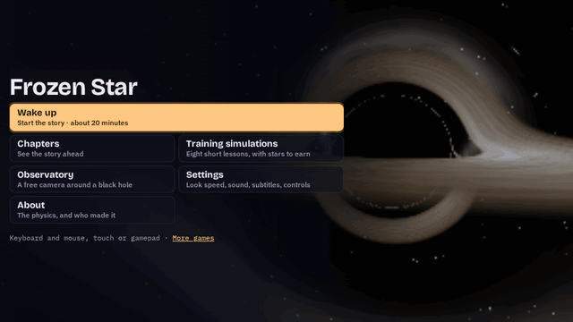
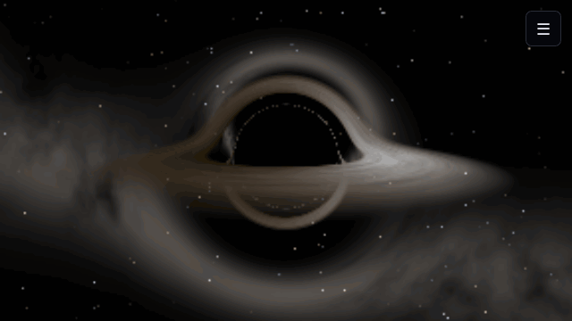
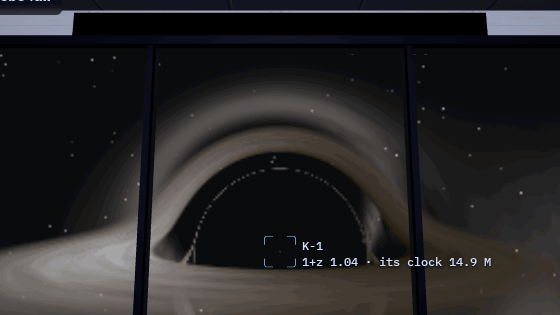
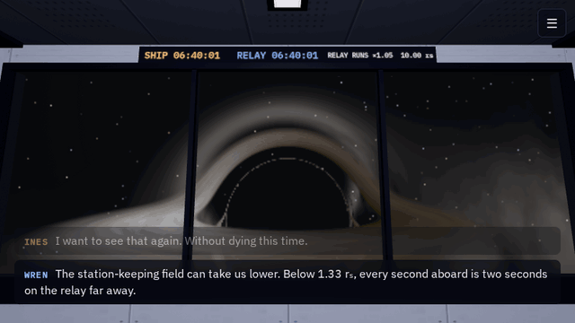
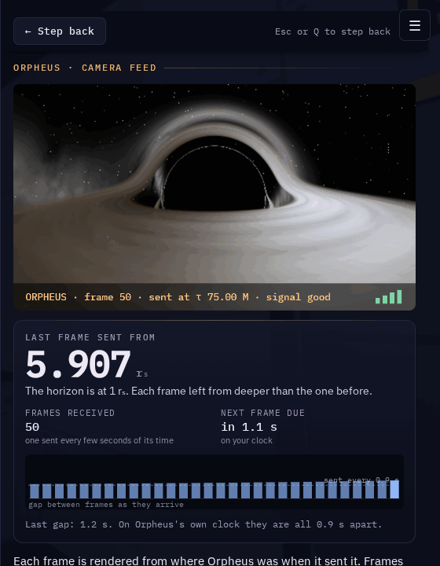
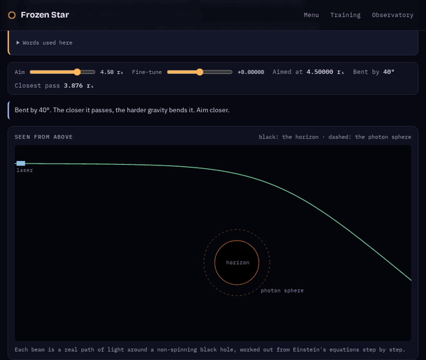

**Frozen Star** is a first-person game about general relativity. You wake aboard the research ship *Tern*, holding station 10 Schwarzschild radii above Erebus, a black hole of 120,000 suns, and find out whether things really fall in. From far away, nothing ever seems to. On its own clock, it falls straight through. Everything outside the windows is a real light-ray trace through curved spacetime, running at its true speed.

This is the first release.

## Download

| Download | How to play |
| --- | --- |
| `frozen-star-0.1.0-win-x64.zip` | **Windows 10/11 x64.** Unzip, then double-click `Frozen Star.exe`. The app is not signed, so if Windows says it protected your PC, choose "More info", then "Run anyway". |
| `frozen-star-0.1.0-web.zip` | **Any computer.** Unzip, serve the folder (`python3 -m http.server 8000`) and open http://localhost:8000/. |
| No download | **In the browser:** https://frozen-star.play.danielstephenson.dev |

The game needs WebGL 2. Add `--lowgpu` (desktop) or `?lowgpu` (browser) on slow graphics. Each zip has a `.sha256` file; check it with `sha256sum -c <file>.sha256`.

## The story

**Prologue: a dream.** You fall through the horizon, ray-traced as the one falling sees it, and nothing happens.

**I · Beacon K-1.** You drop a probe and watch its light freeze at the edge of the shadow, while its beacon's pitch slides down on the speakers.

**II · The rescue.** Ines's capsule drifts in. Her messages arrive slower, redder and deeper. You have to fire the recall beam in time, remembering that the picture on your screen is old light.

**III · The descent.** You take the ship down at the helm until far-away clocks run twice as fast as yours, and you hear both clocks tick.

**IV · Orpheus.** A camera probe's frames arrive further and further apart, until the last one that will ever arrive.

**Epilogue.** A logbook sets what you saw against what happened, using your own numbers. Then the Tern is yours to explore.

## Eight lessons and an observatory

Two Clocks, Last Words, The Rescue, Pick Your Hole, Hover, Bend the Light, Into the Dark and Evaporation are short lessons with stars to earn, and every quiz answer explains itself. The Observatory is a free camera around a black hole.

## The physics is real

The game uses exact Schwarzschild geometry and traces a light ray per pixel in Painlevé–Gullstrand coordinates, so the camera works inside the horizon too. The colours are true Doppler and gravitational shifts, and the formulas are covered by unit tests. See [docs/PHYSICS.md](https://github.com/Preponderous-Software/frozen-star/blob/0.1.0/docs/PHYSICS.md).

## Also in 0.1.0

- Menus with Continue, Chapters and Settings, and support for keyboard and mouse, touch and gamepads; on phones, panels open as a bottom sheet.
- Procedural sound: every room sounds different, the descent can be heard, and the radio reddens.
- Four rounds of AI playtesting, with their fixes; the evidence is in [docs/playtests/0.1.0](https://github.com/Preponderous-Software/frozen-star/tree/0.1.0/docs/playtests/0.1.0).

The full list is in [CHANGELOG.md](https://github.com/Preponderous-Software/frozen-star/blob/0.1.0/CHANGELOG.md). Frozen Star is MIT-licensed.
