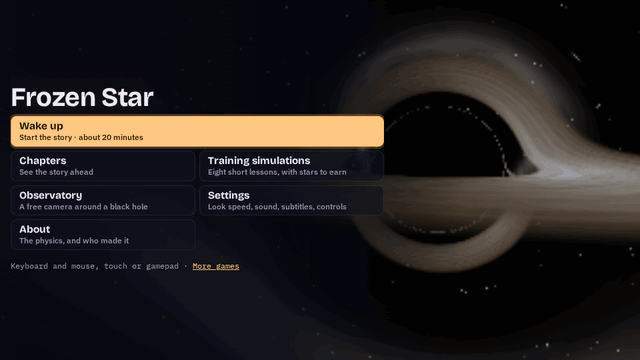
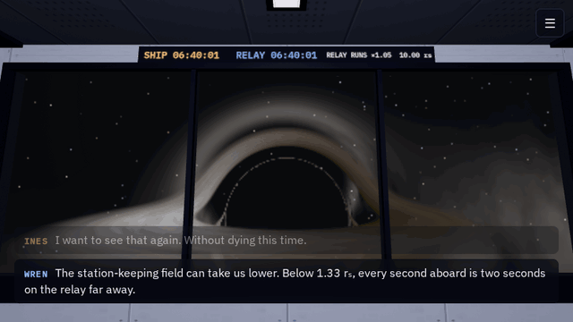

**Frozen Star 0.2.0** gives the crew voices, adds a new chapter about light that goes round in circles, and puts Ines where you can see her.

## Download

| Download | How to play |
| --- | --- |
| `frozen-star-0.2.0-win-x64.zip` | **Windows 10/11 x64.** Unzip, then double-click `Frozen Star.exe`. The app is not signed, so if Windows says it protected your PC, choose "More info", then "Run anyway". |
| `frozen-star-0.2.0-web.zip` | **Any computer.** Unzip, serve the folder (`python3 -m http.server 8000`) and open http://localhost:8000/. |
| No download | **In the browser:** https://frozen-star.play.danielstephenson.dev |

Saves and settings from 0.1.0 carry over.

## What's new

- **Voices.** Ines, the pilot, is voiced by Kokoro-82M's Sky voice. Over the radio during the rescue her voice slows and deepens by exactly her redshift factor 1+z, the same stretch her light gets, until her last words arrive as a slow growl under static. WREN, the ship's AI, speaks in Kokoro's George voice over a clean ship PA, and the two take turns.
- **Postscript · The photon sphere.** After the story, take the Tern down to 1.5 rₛ and fire a laser along the hull. The pulse circles the hole and comes back 11 seconds later, so you could see the back of your own head. A pulse fired one metre higher drifts off and escapes to the stars: the orbit is a knife edge.
- **A capsule bay.** Ines is there in her flight suit doing pre-flight, the capsule launches past the bridge window with its running lights, and it docks again after the rescue.
- **Discoveries and photo mode.** Twenty discoveries, each with a physics fact; press P to freeze time, hide the HUD and save a full-resolution picture.
- **Controls and accessibility.** Rebind every key and gamepad button; reduce flashing, subtitle background, console text size, hold or toggle run, and colour-safe redshift.
- **A smoother ring.** The thin photon ring around the shadow is now a continuous line on modest GPUs, and the sky's resolution climbs where the frame rate allows.
- **Her climb home.** After the rescue, once the light of her engine burn reaches you, you see the capsule climb back out, its light losing its redshift as it comes.
- **Many fixes** from four more rounds of AI playtesting: the full list is in [CHANGELOG.md](https://github.com/Preponderous-Software/frozen-star/blob/0.2.0/CHANGELOG.md), and the evidence in [docs/playtests/0.2.0](https://github.com/Preponderous-Software/frozen-star/tree/0.2.0/docs/playtests/0.2.0).

Voices: Kokoro-82M (Apache-2.0), see [docs/THIRD-PARTY.md](https://github.com/Preponderous-Software/frozen-star/blob/0.2.0/docs/THIRD-PARTY.md). Frozen Star is MIT-licensed.
