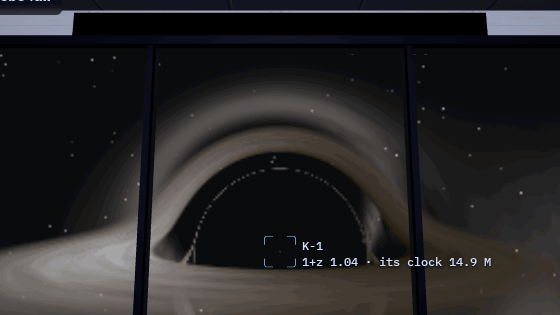

**Frozen Star 0.3.0** is a polish release. The ship no longer flashes out of sight, being aboard feels more alive, and the whole game got a pass for touch screens, pacing and robustness.

## Download

| Download | How to play |
| --- | --- |
| `frozen-star-0.3.0-win-x64.zip` | **Windows 10/11 x64.** Unzip, then double-click `Frozen Star.exe`. The app is not signed, so if Windows says it protected your PC, choose "More info", then "Run anyway". |
| `frozen-star-0.3.0-web.zip` | **Any computer.** Unzip, serve the folder (`python3 -m http.server 8000`) and open http://localhost:8000/. |
| No download | **In the browser:** https://frozen-star.play.danielstephenson.dev |

Saves and settings from 0.1.0 and 0.2.0 carry over.

## What's new

- **The ship stays on screen.** On some PCs the ship's interior flashed away for a single frame, leaving only the black hole. The cause was the automatic resolution change: it resized the ship's layer just after drawing it, and a resized layer is blank until it is drawn again. Resizes now happen before the draw, and the resolution no longer swings back and forth.
- **Feel aboard.** Footsteps follow your stride, with a gentle head bob (it can be turned off in Settings, and is off with reduced motion). The ship's hum ducks under dialogue, the hull creaks as you go deeper, and doors and consoles answer with small sounds.
- **Interior art.** Sealed hatches look like closed doors from every angle, the quarters have a padded headboard and shelf, and the consoles, racks, benches and cable trays are textured.
- **Touch screens.** Thumb-sized buttons, consoles as a full-height side panel in landscape, a resting joystick, and photo mode by touch. Screen readers get proper labels for the menu, objectives and choices.
- **Smoother story.** Objectives tick off the moment things happen; Ines's question and the Postscript prediction come up without stepping back from the console; a failed rescue is marked "Too late"; the helm has one-press ×2, ×4 and 1.5 rₛ buttons; the spacetime map keeps finished falls in view and its labels no longer overlap.
- **Sturdier.** Short key taps count even at low frame rates, the page no longer freezes while the ship's shaders compile, an error shows a small notice instead of stopping the game, and damaged saves or settings fall back safely.
- **Physics wording.** The Orpheus feed now says why its frames stop: the next one was due from inside the horizon, and nothing sent from there gets out.

The full list is in [CHANGELOG.md](https://github.com/Preponderous-Software/frozen-star/blob/0.3.0/CHANGELOG.md), and the AI playtest evidence in [docs/playtests/0.3.0](https://github.com/Preponderous-Software/frozen-star/tree/0.3.0/docs/playtests/0.3.0).

Voices: Kokoro-82M (Apache-2.0), see [docs/THIRD-PARTY.md](https://github.com/Preponderous-Software/frozen-star/blob/0.3.0/docs/THIRD-PARTY.md). Frozen Star is MIT-licensed.
